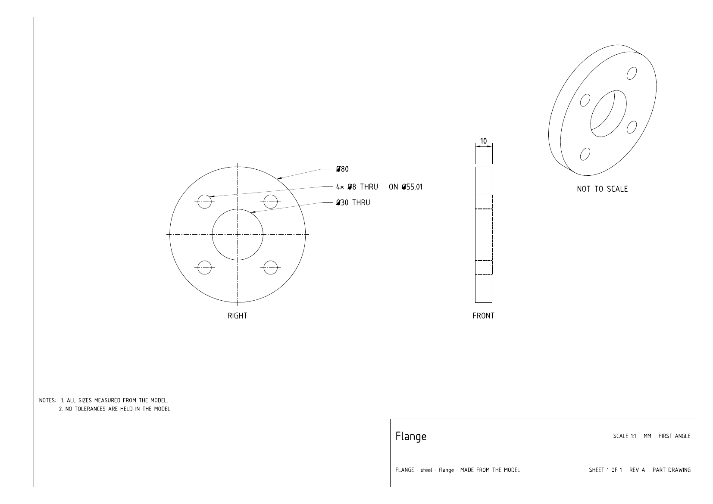
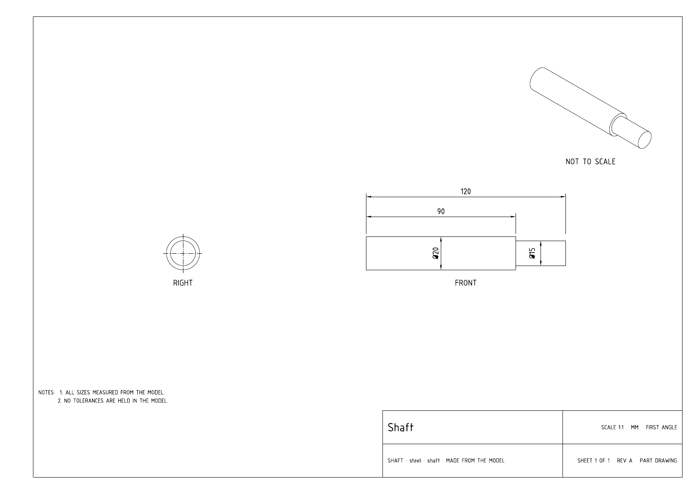
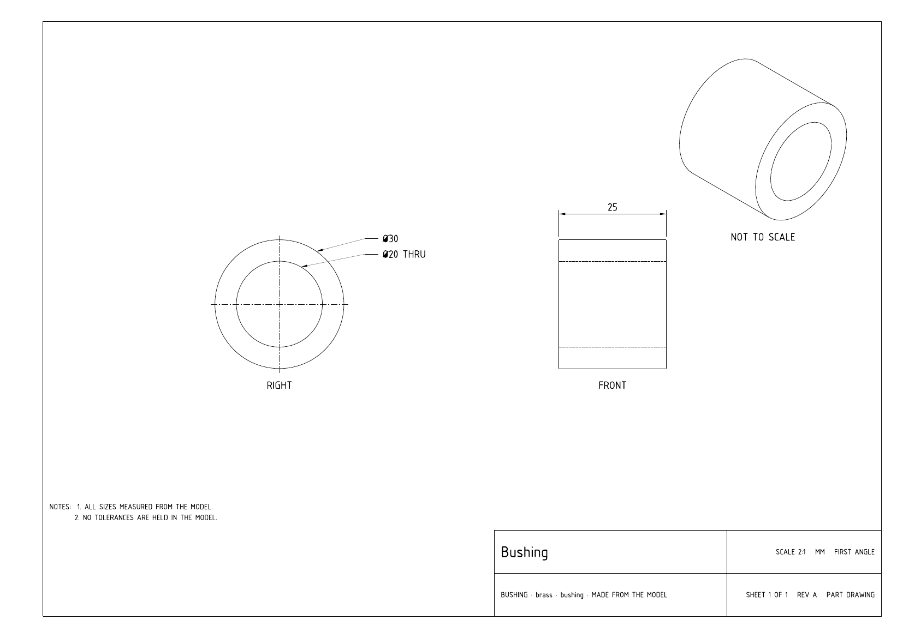
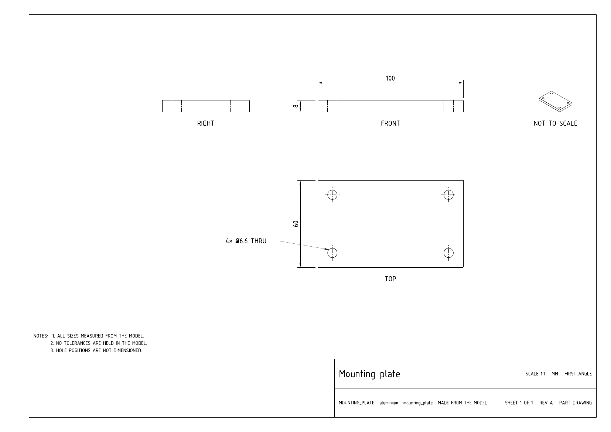
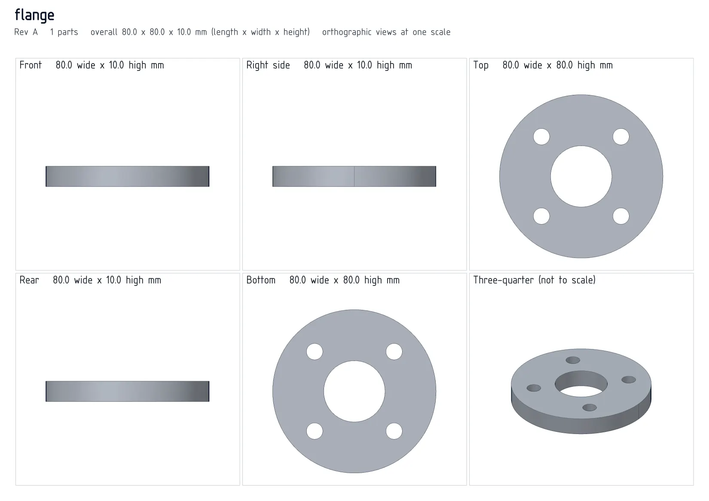
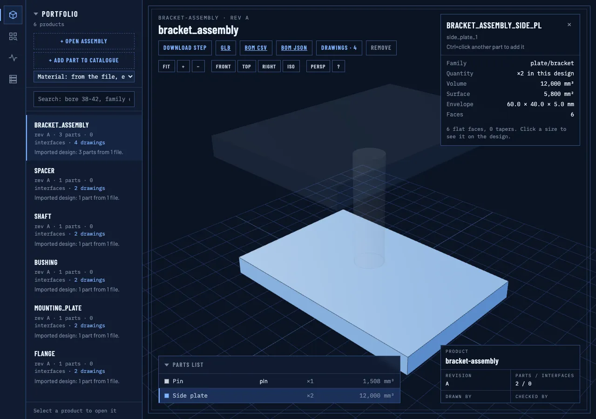
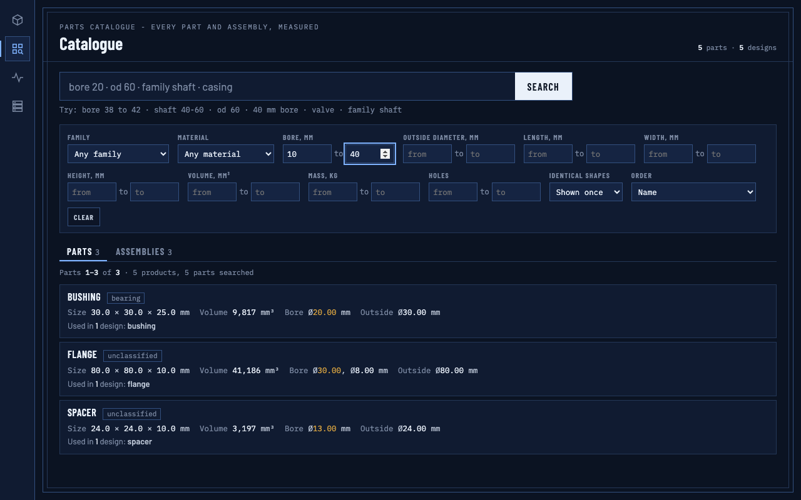
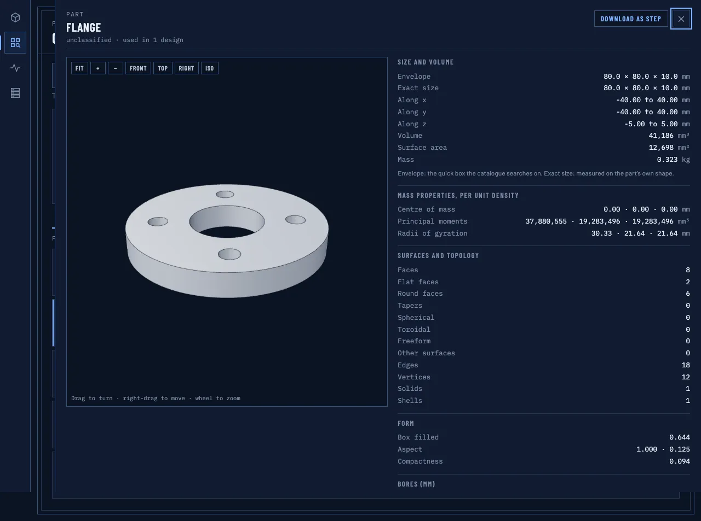
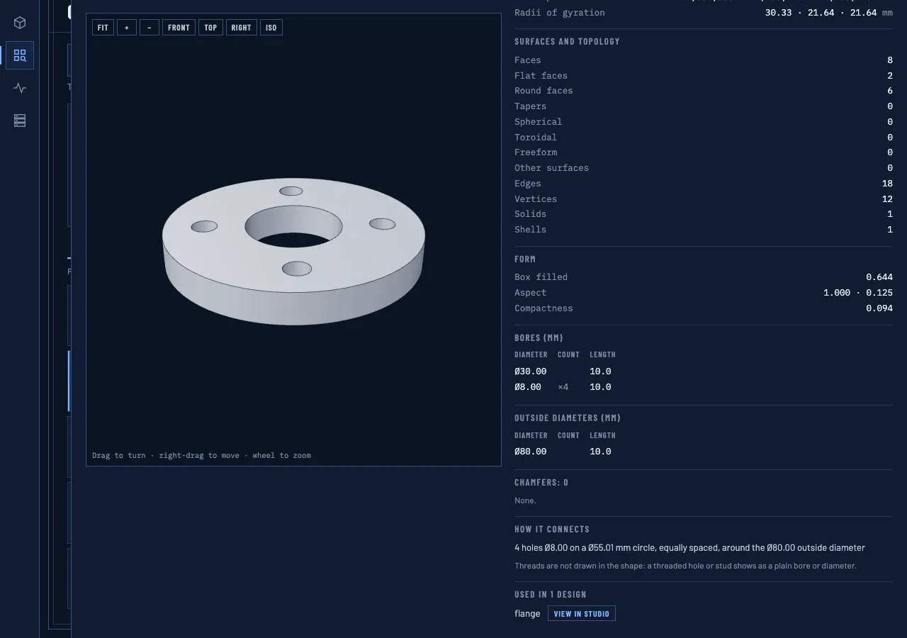

# Buildcore

[](https://github.com/naman113/Designstudio/actions/workflows/ci.yml)
[](LICENSE)
[](docker/Dockerfile)
[](compose.yaml)

Give it a STEP file: get a dimensioned engineering drawing, a bill of materials with identical parts counted, a 3D model in the browser and a searchable parts catalogue.


The demo above was recorded from a fresh `docker compose up`: the sample assembly is opened, its parts list picked,
its drawings shown (assembly sheet, then a part sheet), then the 3D view and a catalogue search by bore diameter.

## Contents

- [Quick start](#quick-start)
- [What you get](#what-you-get)
- [Capabilities in detail](#capabilities-in-detail)
  - [Reading the STEP file](#reading-the-step-file)
  - [Part drawings](#part-drawings)
  - [Assembly drawing](#assembly-drawing)
  - [Views sheet](#views-sheet)
  - [The read-back check](#the-read-back-check)
  - [Bill of materials](#bill-of-materials)
  - [3D view and GLB export](#3d-view-and-glb-export)
  - [Catalogue of single parts](#catalogue-of-single-parts)
- [Example outputs](#example-outputs)
- [CLI](#cli)
- [Who it is for](#who-it-is-for)
- [Limitations and what is not supported](#limitations-and-what-is-not-supported)
- [How it works](#how-it-works)
- [Configuration](#configuration)
- [Running the tests](#running-the-tests)
- [Contributing](#contributing)
- [Licence and credits](#licence-and-credits)

## Quick start

Requires Docker with Compose.

```sh
git clone https://github.com/naman113/Designstudio.git
cd Designstudio
docker compose up -d
```

Open http://127.0.0.1:8800.

The first start builds the image and then loads six sample files: five single parts (flange, bushing, mounting plate,
shaft, spacer) and a small assembly (`bracket_assembly`: two side plates and a pin). The assembly's drawings are made
on that first start, so it is ready to look at as soon as the loader has finished.

- Stop: `docker compose down` (your designs and the catalogue are kept in Docker volumes).
- Full reset to an empty studio: `docker compose down -v`. This removes every volume of the stack. Removing only the
  database volume is not enough, because the designs and drawings live in other volumes; on the next start the samples
  are loaded again.
- Another host port: `BC_PORT=8810 docker compose up -d` (the studio is always bound to 127.0.0.1 only).
- After changing the code: `docker compose up -d --build`.

In the studio, **Open assembly** opens a STEP file as a design (drawings, BOM, 3D) and **Add part to catalogue** adds a
single part to the catalogue. The catalogue page is the grid icon in the left rail.

## What you get

| Input | What Buildcore does | Output | Formats |
|-------|---------------------|--------|---------|
| STEP assembly or part | One sheet per distinct part, views and dimensions placed from the measured geometry, every printed number read back and checked | Part drawings | PDF (one page per sheet) |
| STEP assembly | Three views and a three-quarter view, balloons, envelope sizes and a parts list | Assembly drawing | PDF |
| STEP assembly or part | Six shaded views on one sheet with their measured widths and heights | Views sheet | PNG |
| STEP assembly | Identical parts grouped and counted, readable names, bought-in parts marked | Bill of materials | CSV, JSON |
| STEP assembly or part | Tessellated model, one node per part, with edges | 3D view in the browser, model download | GLB (binary glTF), STEP |
| STEP single part | Measured sizes, mass, diameters, holes, topology and form stored in Postgres | Searchable parts catalogue | Web page, CLI, JSON |

- **Part drawings.** One sheet per distinct part, first-angle projection, with the views and dimensions placed
  automatically. Sheet size (A3 to A0) and scale are chosen automatically: the first standard size and scale where the
  views fit with no text or dimension overlapping (if none does, the fit with the fewest overlaps, and their count is
  reported).
- **Assembly drawing.** Front, top and right views plus a three-quarter view, balloons on every part and a parts list
  (item, part, quantity, material, size L x W x H).
- **Bill of materials.** Identical parts are grouped and counted, also when the copies are rotated or moved. Download as
  CSV or JSON.
- **3D view.** The design in the browser (three.js): turn, zoom, standard views, pick parts from the parts list. The model
  can be downloaded as GLB.
- **Parts catalogue.** Every single part with its measured length, width and height, volume, surface area, mass (from
  the material's density), bore and outer diameters, hole count and material. Filters are exact ranges (bore 10 to 40 mm
  returns only parts with a measured bore in that range), plus family, material and name words.
- **Web UI and CLI.** The same functions from the browser or from the command line.

## Capabilities in detail

Everything in this section describes what the code in `framework/` does today. File references point at the module that
implements each rule.

### Reading the STEP file

`framework/kernel/io.py`

1. The file is read through OpenCASCADE's XCAF reader with names, colours and materials switched on. Only `.step` and
   `.stp` files that start with the STEP header (`ISO-10303-21`) are accepted, up to 300 MB.
2. Lengths are converted to millimetres when the file uses another unit (the conversion is logged).
3. The assembly tree is walked. Every non-assembly shape that holds at least one solid becomes a part; a shape with no
   solid is skipped and logged. Repeated placements of the same STEP shape become one part with a quantity.
4. A part is named from the STEP label; a part with no name is called `Part<n>`. Two different parts with the same name
   get `_2`, `_3`, ... appended to their reference.
5. The material name is taken from the STEP file when it carries one.
6. Each shape is checked with `BRepCheck_Analyzer`. An invalid shape is repaired with `ShapeFix_Shape` (first at a tight
   precision of 1e-7, then with default settings); which parts were healed is logged.

### Part drawings

`framework/kernel/drawings/autodim.py`, `framework/kernel/drawings/sheet.py`

**What goes in:** one part of a design. **What comes out:** one PDF sheet per distinct part (identical parts share one
sheet). Parts whose readable name or reference contains a bought-in word (bearing, seal, o ring, circlip, screw, bolt,
nut, washer, dowel, stud, rivet, grub, and their plurals; `framework/catalog/bought_in.json`) are listed on the parts
list but not drawn. A design of a single part always draws that part.

**Step by step**

1. **Measure.** The part's tight extent (exact, not from a mesh) and its feature list are taken from the B-rep:
   cylinders (with a bore or outside-diameter role), planes and cones.
2. **Bore or outside diameter.** For each cylindrical face the kernel steps a short distance radially inward from a point
   on the face. Material there means an outside diameter; air means a bore (`framework/kernel/features.py`). Before a
   drawing uses a "bore", it is probed again at 8 angles and 3 positions along its length, and a majority vote can turn
   it back into an outside diameter (this catches a probe that landed inside a keyway).
3. **Full circles only.** A cylinder is treated as a hole only when its faces cover 360 degrees (each face at least 170
   degrees). Partial arcs, such as fillets or open cavities, are not called out as holes.
4. **Through or blind.** A hole is THRU only when the points 0.5 mm past both ends, on the axis and at 0.97 of the radius
   in four directions, are outside the solid and no coaxial bore of the same group continues there. Otherwise the
   callout gives its depth (`↧`). A stepped bore shows each step's own depth.
5. **Classify.** A part is *turned* when its largest coaxial cylinder group has an outside diameter equal to both cross
   extents (within 1 %). A turned part is a *shaft* when its length exceeds its largest diameter, otherwise a *disc*.
   Anything else is *prismatic* (castings included).
6. **Orient.** A turned part whose axis is Y or Z is turned rigidly so its axis lies along X. Sizes do not change.
7. **Lay out and dimension** (rules below), then try sheet sizes and scales in order until one fits.
8. **Read back** every number from the finished sheet ([below](#the-read-back-check)). A sheet that fails is not
   written.

**Views and projection**

- First-angle projection, stated in the title block. The view from the right stands to the left of the front view; the
  view from above stands below it.
- Turned parts with no cross holes or keyway slots get two orthographic views (end view and profile). All other parts
  get three (front, top, right).
- Every sheet also has a three-quarter view in the top-right corner, labelled NOT TO SCALE, without hidden lines.
- Orthographic views show visible lines and hidden lines (dashed) from an exact hidden-line pass (`HLRBRep_Algo`), and a
  centre-mark cross on every circle centre (one cross per centre, sized to the largest circle on it).

**Dimensions placed on a prismatic part**

- The three overall sizes: length and height on the front view, width on the top view. They are measured between
  exact extent points, never off projected edges.
- Up to 8 hole groups, largest diameter first, each on the view that looks along the hole axis: count (`4×`), diameter
  (`Ø`), and `THRU` or the depth. Only holes whose axis is parallel to X, Y or Z are called out.
- Hole positions are not dimensioned. The sheet says so in a note: "HOLE POSITIONS ARE NOT DIMENSIONED."

**Dimensions placed on a turned part (shaft or disc)**

- One diameter per distinct outside step, on its longest occurrence. On a shaft the diameter is a dimension line across
  its own step on the profile (texts that would collide are spread apart); on a disc it is a leader on the end view.
- Shoulders: planes square to the axis between the two end faces, given as baseline dimensions from the left end face
  (up to 8 on a shaft, 3 on a disc), with the overall length outermost.
- Up to 6 coaxial bores on the end view, with `THRU` or depth.
- Holes parallel to the axis, grouped by diameter and depth, with their count; when 3 or more lie on one circle the
  callout adds the pitch circle, for example `4× Ø8 THRU ON Ø55.01`.
- Holes square to the axis (cross holes) on the view along their axis.
- Keyway slot ends (a half-cylinder square to the axis, on a radial line) as `SLOT <width> WIDE ↧<depth>`.

**Numbers and text**

- Sizes print with up to two decimals, trailing zeros dropped (`10`, `55.01`). Units are millimetres.
- Notes on every part sheet: "ALL SIZES MEASURED FROM THE MODEL." and "NO TOLERANCES ARE HELD IN THE MODEL."
- Title block: part name; part reference, material, design name and "MADE FROM THE MODEL"; scale, units and projection;
  sheet number, revision and document type (PART DRAWING). The lettering is osifont (ISO 3098), embedded in the PDF.
- 20 mm filing margin on the left (ISO 5457).

**Sheet size and scale.** These (sheet, scale) pairs are tried in order; the first where everything stays inside the
frame, no two views overlap and no annotation overlaps another wins:

A3 2:1, A3 1:1, A3 1:2, A3 1:2.5, A2 1:2, A2 1:2.5, A3 1:5, A2 1:5, A1 1:5, A1 1:10, A1 1:20, A0 1:20, A1 1:50, A0 1:50.

If every fitting pair has an overlap, the one with the fewest is used and the number of overlaps is reported. If none
fits, the part is listed as failed with "it does not fit on the largest sheet".

**Failure reasons** shown for a part: "it took too long" (a part still being drawn after 240 s is stopped;
`GEO_PART_LIMIT_S`), "a size did not match the model" (the read-back check failed), "it could not be drawn", "it does not
fit on the largest sheet". Sheets already made for other parts are kept.

| Flange (disc, hole circle) | Shaft (stepped, shoulder baseline) |
|---|---|
| [](docs/examples/part-flange.pdf) | [](docs/examples/part-shaft.pdf) |
| **Bushing (disc, through bore, 2:1)** | **Mounting plate (prismatic, hole group)** |
| [](docs/examples/part-bushing.pdf) | [](docs/examples/part-mounting-plate.pdf) |

Click a sheet for its PDF.

### Assembly drawing

`framework/kernel/drawings/assembly.py`

- First-angle front, top and right views, and a three-quarter view (NOT TO SCALE) in the free corner under the right
  view. Hidden lines are not drawn on the assembly sheet.
- The three envelope sizes of the whole design, measured between exact extent points.
- A balloon with the item number on every part that can be seen. The balloon goes in the view where most of the part is
  visible, at its most interior visible point. A part with fewer than 40 visible pixels in every view gets no balloon and
  is listed as "(inside)".
- A parts list above the title block: ITEM, PART, QTY, MATERIAL, SIZE L x W x H (mm), item 1 at the bottom. Above 30
  rows it continues on further sheets with the same frame and title block.
- Sheets and scales tried in order: A2 1:2, 1:2.5, 1:5; A1 1:2 to 1:50; then A0 1:50, A1 1:100, A0 1:100, A1 1:200,
  A0 1:200, A0 1:500.
- The same read-back check as the part drawings, with envelope sizes, parts-list numbers and balloon numbers checked
  separately so one cannot hide behind another's value.


### Views sheet

`framework/kernel/drawings/views.py`

A 3300 x 2333 px PNG with six shaded views of the design: front, right side, top, rear and bottom at one shared scale,
and a three-quarter view at its own scale. The header gives the revision, the part count and the overall size; each view
caption gives that view's width and height in mm (one decimal). It is a captioned picture grid, so it carries no
projection label. Its numbers are checked against values recomputed from the exact extents before the sheet is
published.



### The read-back check

`framework/kernel/drawings/check.py`

Each number the layout rules place is recorded with the kernel value it came from. After the sheet is drawn, the
finished document is read back: the text inside every dimension block, every hole and slot callout, the title block and
the notes. Then:

- a number in a dimension or callout that matches no placed value is **unexplained**;
- a placed value that is not found on the sheet is **missing**;
- a placed text that is not the standard format of its kernel value is **wrong**;
- a number in the title block or notes must be one of the expected sheet furniture (names, reference, revision, sheet
  size, scale, "SHEET 1 OF 1", note numbering);
- a word guard rejects tool names, file names and paths in the sheet's own text. Names you chose (design and part
  names) are only reported as a warning.

A part sheet with any unexplained, missing or wrong number, or a word-guard hit, is not written; the part is listed as
failed with "a size did not match the model".

### Bill of materials

`framework/catalog/drawing_bom.py`, `framework/web/app.py`

1. **Rows.** One row per part reference in the order of the design, with the quantity summed over its placements.
2. **Identical parts.** Two references are the same part when they share this key: volume, surface area and the three
   principal moments of inertia, each to 3 significant figures, with the moments sorted; the face count; and the material
   in lower case. None of these change when a part is moved or rotated, so a rotated copy groups with the original.
   The bounding box is deliberately not used (it changes when a part is rotated). A part that has not been measured stays
   on its own row.
3. **Names.** A STEP label with a space or a comma is kept as written (first letter capitalised). Otherwise the label
   (or the reference, when the label is generic such as "Part", "Solid", "Body" or a long unbroken source name) is split
   at underscores, hyphens, lower-to-upper case changes and letter-to-digit boundaries: `OUTPUT_SHAFT` and `OutputShaft`
   both read "Output shaft". A grouped row is named by the words all its members share.
4. **Material.** "-" when the STEP file gives none.
5. **Bought in.** "yes" when any member's readable name or reference contains a whole word of the bought-in list.
6. Items are numbered 1, 2, ... after grouping. The parts list is limited to 2,000 rows.

| Format | Columns |
|--------|---------|
| CSV | `item, name, qty, material, bought_in, ref` (a cell starting with `=`, `+`, `-`, `@`, tab or carriage return is prefixed with `'` so a spreadsheet runs no formula) |
| JSON | `product_id, name, revision, rows[]`; each row `item, ref, name, label, qty, material, bought_in`, and `refs` (how many references were grouped) on grouped rows |

The sample's JSON ([file](docs/examples/bracket_assembly-bom.json)) shows two separate side-plate references grouped
into one row:

```json
{"product_id": "bracket-assembly", "name": "bracket_assembly", "revision": "A",
 "rows": [{"item": 1, "ref": "BRACKET_ASSEMBLY_SIDE_PL", "name": "Side plate", "label": "side_plate_1",
           "qty": 2, "material": "-", "bought_in": false, "refs": 2},
          {"item": 2, "ref": "BRACKET_ASSEMBLY_PIN", "name": "Pin", "label": "pin",
           "qty": 1, "material": "-", "bought_in": false}]}
```

### 3D view and GLB export

`framework/kernel/partview.py`, `framework/web/static/index.html`

**Mesh.** Each part is tessellated from its exact shape: angular deflection 0.15 rad, linear deflection 0.0004 x the
diagonal of the part's box (clamped to 0.01 to 0.5 mm). Normals are averaged within each face, so curved faces look
smooth and real edges stay sharp. The B-rep edges are written as line geometry. For the catalogue's single-part view,
faces that fall short of the part's exact extent are meshed again, finer, until the box matches within 0.004 mm.

**GLB file.** One binary glTF per design: a node per part placement named by its reference, with `extras.ref`, and an
edge node `<ref>__edges` per part. The file's `asset.extras` states `units: mm` and `up: Z`. A part that cannot be
meshed is skipped rather than failing the whole file. The same file feeds the browser view and the GLB download.

**Viewer controls**

| Action | Mouse | Key |
|--------|-------|-----|
| Turn | drag | |
| Move | right-drag or Shift+drag | |
| Zoom where you point | wheel | `+` / `-` |
| Fit everything | double-click empty space, or **Fit** | `F` |
| Frame one part | double-click the part | |
| Front, right, top, iso view | buttons | `1`, `3`, `7`, `0` |
| Perspective / parallel projection | **Persp** button | `P` |
| Clear selection | | `Esc` |

**Colouring and selection.** Identical parts (the same group as the BOM) share one colour; groups beyond the palette get
their own hue, so colours do not repeat. Clicking a part or a parts-list row selects it, makes the other parts
see-through and shows a card with its family, quantity, volume, surface area, envelope and face count. Ctrl+click adds
another part to the selection.

**Downloads from the design header:** STEP (the whole design, AP214, millimetres, parts named by reference), GLB,
BOM CSV, BOM JSON, and the drawings.



### Catalogue of single parts

`framework/kernel/measure.py`, `framework/catalog/query.py`, `framework/web/static/catalogue.html`

**What goes in:** a STEP file holding one solid (**Add part to catalogue**, or `buildcore add`). A file with more than one
part is refused with a message to add each part on its own.

**What is measured and stored for each part**

| Group | Values | Units |
|-------|--------|-------|
| Size | envelope (bounding box sides sorted largest first: length, width, height), box min/max along x, y, z, exact size measured on the shape | mm |
| Volume, area | volume, surface area | mm³, mm² |
| Mass | volume x density of the material; with no material the density of steel is used and the mass is marked as assumed ("Mass, about") | kg |
| Mass properties per unit density | centre of mass, three principal moments, three radii of gyration | mm, mm⁵, mm |
| Surfaces and topology | faces, and how many are flat, cylindrical, conical, spherical, toroidal, freeform or other; edges, vertices, solids, shells | count |
| Form | box filled (volume / box volume), two aspect ratios (width / length, height / length), compactness (volume^(2/3) / area) | ratio |
| Diameters | bores and outside diameters, each with count and length along its axis | mm |
| Chamfers | conical faces, counted and listed | count |
| How it connects | bore count, largest and smallest bore, hole patterns (2 or more equal bores on separate parallel axes, on a circle or in a row) | count, mm |
| Family | from ordered rules in `framework/catalog/families.json`: bearing, building element, crankshaft, cylinder/actuator, fastener, gearbox, housing/block, pin/shaft, plate/bracket, shaft, or unclassified | |
| Material | name from the materials list | |

**Volume and area accuracy.** For each solid, OpenCASCADE's default integration and an adaptive integration are
compared. When they agree within 1.5e-4 (relative) the formula value is used; when they do not, that solid is measured
on a two-level triangulation instead, and an error estimate is stored with the value.

**Materials and densities** (`framework/catalog/materials.json`): steel 7850, stainless steel 8000, cast iron 7200,
aluminium 2700, brass 8500, bronze 8800, copper 8960, titanium 4430, plastic (nylon) 1140, plastic (acetal) 1410, rubber
1200 kg/m³. A material name is matched by whole words against each entry's aliases (for example `s355`, `c45` and
`4140` are steel; `304`, `316` and `inox` are stainless steel).

**Filters.** All filters are ANDed. Each range takes a minimum, a maximum or both (inclusive).

| Filter | Meaning | Units |
|--------|---------|-------|
| Family | equals | |
| Material | equals, any letter case | |
| Bore | the part has a bore feature in this range | mm |
| Outside diameter | the part has an outside-diameter feature in this range | mm |
| Length | largest envelope side | mm |
| Width | middle envelope side | mm |
| Height | smallest envelope side | mm |
| Volume | | mm³ |
| Mass | | kg |
| Holes | number of separate bore axes | count |
| Identical shapes | shown once (with every design that uses any copy) or each listed | |
| Order | name, volume largest or smallest first, length longest first, most used | |

The search box also reads short phrases such as `bore 38 to 42`, `od 60` or `40 mm bore`, and with plain words the
designs whose name holds every word are listed first. Results are split into Parts and Assemblies tabs, 25 per page, and every answer says how much was
searched ("5 products, 5 parts searched"), so an empty result cannot be mistaken for an unsearched one. A part's page
shows its own 3D view, all the values above, the designs that use it, the other parts with the identical shape, and a
STEP download of the part alone.

| Search by bore, 10 to 40 mm | One part's record |
|---|---|
|  |  |



## Example outputs

All produced by the app from the generated sample files:

| Output | Files |
|--------|-------|
| Assembly drawing, `bracket_assembly` | [PDF](docs/examples/bracket_assembly-assembly.pdf), [PNG](docs/examples/bracket_assembly-assembly.png) |
| Part drawing, side plate of `bracket_assembly` | [PDF](docs/examples/bracket_assembly-part.pdf) |
| Part drawings, flange, shaft, bushing, mounting plate | [flange](docs/examples/part-flange.pdf), [shaft](docs/examples/part-shaft.pdf), [bushing](docs/examples/part-bushing.pdf), [mounting plate](docs/examples/part-mounting-plate.pdf) (PDF) |
| Views sheet, flange | [image](docs/examples/flange-views.webp) |
| Bill of materials, `bracket_assembly` | [CSV](docs/examples/bracket_assembly-bom.csv), [JSON](docs/examples/bracket_assembly-bom.json) |
| 3D view | [design](docs/examples/bracket_assembly-3d.png), [part selected](docs/examples/studio-part-selected.webp) |
| Catalogue | [bore 10 to 40 mm](docs/examples/catalogue-filter.png), [part page](docs/examples/catalogue-part.webp), [part diameters](docs/examples/catalogue-part-features.webp) |


The BOM CSV:

```
item,name,qty,material,bought_in,ref
1,Side plate,2,-,no,BRACKET_ASSEMBLY_SIDE_PL
2,Pin,1,-,no,BRACKET_ASSEMBLY_PIN
```

## CLI

The CLI talks to the running stack, so start it first with `docker compose up -d`.

The examples below use the sample STEP files. A clone does not contain them (they are generated), so write them into
`buildcore-samples/` first (on Linux add `--user "$(id -u):$(id -g)"` after `run` so the files belong to you):

```sh
docker compose run --rm --entrypoint python cli -m framework.samples.make buildcore-samples
```

**Through Docker** (nothing to install). The repository folder is mounted as the working folder, so the STEP file must be
in it and the outputs are written next to it:

```sh
docker compose run --rm cli drawing buildcore-samples/bracket_assembly.step
```

**On the host** with plain `python3` (standard library only), from a clone:

```sh
scripts/buildcore drawing buildcore-samples/bracket_assembly.step            # drawing sheets (PDF) and the views sheet (PNG)
scripts/buildcore bom buildcore-samples/bracket_assembly.step --format csv   # bill of materials as CSV (or --format json)
scripts/buildcore glb buildcore-samples/bracket_assembly.step                # 3D model as GLB
scripts/buildcore add buildcore-samples/spacer.step --material bronze --name spacer_bronze   # add one part to the catalogue
scripts/buildcore find --bore 10:40                  # search the catalogue: parts with a bore of 10 to 40 mm
```

Every command works the same through Docker: replace `scripts/buildcore` with `docker compose run --rm cli`.

| Command | Input | Output |
|---------|-------|--------|
| `drawing` | STEP file or `--id` | every sheet the studio made: `part-<REF>.pdf` per drawn part, the assembly drawing PDF for an assembly, and `views.png`; `--timeout` seconds to wait (default 900) |
| `bom` | STEP file or `--id` | `<name>-bom.json` or `.csv` (`--format json|csv`, default json), and a table on the terminal |
| `glb` | STEP file or `--id` | `<name>.glb` |
| `add` | STEP file with one solid | the part in the catalogue; `--material` (default: the file's own, else steel), `--name` (default: the file name) |
| `find` | filters | a table of matching parts, or the server's answer with `--json` |

- `drawing`, `bom` and `glb` open the STEP file as a temporary design, fetch the result and remove the design again
  (`--keep` keeps it in the studio). `--id <product id>` uses a design that is already in the studio instead of a file.
- Outputs go to `./buildcore-out/<name>/`; `-o DIR` writes them elsewhere.
- `add` takes a file holding one solid; an assembly is refused with a message to add each part on its own.
- `find` takes ranges as `MIN:MAX` for `--bore`, `--od`, `--length`, `--width`, `--height`, `--volume`, `--mass` and
  `--holes`, plus `--family`, `--material`, `--words`, `--kind parts|assemblies`, `--sort`, `--limit` and `--json`.
- `--url` (before the command) points at another stack; the default is `BUILDCORE_URL`, else http://127.0.0.1:8800.
- Exit codes: 0 done, 1 the server refused or the work failed, 2 bad arguments, 3 the server is not reachable.
- `scripts/buildcore <command> --help` lists every option.

```
$ scripts/buildcore find --limit 10
bushing                    bearing      30.0 x 30.0 x 25.0     vol 9817       bore 20.00        in bushing
flange                     unclassified 80.0 x 80.0 x 10.0     vol 41186      bore 30.00,8.00   in flange
mounting_plate             plate/bracke 100.0 x 60.0 x 8.0     vol 46905      bore 6.60         in mounting-plate
shaft                      pin/shaft    120.0 x 20.0 x 20.0    vol 33576      bore -            in shaft
spacer                     unclassified 24.0 x 24.0 x 10.0     vol 3197       bore 13.00        in spacer
5 parts (5 products, 5 parts searched)
```

## Who it is for

- **Design and manufacturing engineers** who receive STEP files and need a first dimensioned print, a parts count or a
  quick look at the geometry without opening a CAD seat.
- **Drawing checks.** Every size on a sheet comes from the model and is read back, so the sheets can be used to check a
  supplier model's main sizes, bores and hole patterns.
- **Purchasing and planning.** A BOM with identical parts counted (including rotated copies) and bought-in parts marked,
  as CSV for a spreadsheet or JSON for another tool.
- **Part reuse.** A searchable record of parts you already have: find every part with a 20 mm bore, a plate under 2 kg,
  or a shaft between 100 and 150 mm long, and see which designs use it.
- **Developers** who want a self-hosted STEP pipeline (drawings, BOM, GLB, measurements) behind a web API or CLI.

## Limitations and what is not supported

- **Input format.** STEP only (`.step`, `.stp`), up to 300 MB per file. No native CAD formats, no IGES, no meshes as
  input.
- **No tolerances, fits, GD&T, surface finish or weld symbols.** STEP geometry carries none of these, so every sheet says
  "NO TOLERANCES ARE HELD IN THE MODEL."
- **Dimensions not placed:** hole positions on prismatic parts (sizes, counts and depths only, with a note), radii and
  fillets, chamfer sizes, angles, and positions of cross holes. Holes on an oblique axis and partial arcs are not called
  out.
- **No section views, detail views or auxiliary views.** Part sheets have two or three orthographic views and one
  three-quarter view.
- **Limits per sheet:** at most 6 coaxial bores, 8 hole groups and 8 shoulders (3 on a disc).
- **Threads** are not modelled in STEP: a threaded hole or stud shows as a plain bore or diameter.
- **First-angle projection only** in the studio.
- **Bought-in parts are not drawn.** They are recognised by name only (the word list above), not by shape.
- **Assembly drawings** have no hidden lines and dimension only the overall envelope.
- **The drawings are PDF only.** No DXF or DWG output.
- **The GLB is a tessellated mesh**, not exact geometry. Use the STEP download for exact geometry.
- **Shape-similarity ranking** by D2 histogram or moments is not available in the catalogue search.
- **Time and size limits:** a part still being drawn after 240 s is stopped and reported; a parts list is limited to
  2,000 rows.
- **No user accounts or access control.** The studio is bound to 127.0.0.1 and is meant for one machine.

## How it works

- **Geometry.** STEP files are read with build123d on the OpenCASCADE kernel (OCP). Each solid is measured from the
  B-rep: bounding box, volume, surface area, principal moments of inertia, cylindrical faces (bores and outer
  diameters) and holes.
- **Drawings with a read-back check.** Every number printed on a sheet is measured from the model. After a sheet is
  drawn, its printed text is read back from the finished sheet and compared with values recomputed from the geometry. A
  wrong, missing or unexplained number fails the check. A part or assembly sheet that fails is not written: the part is
  listed as failed with the reason. The
  sheet engine is derived from cadgen and uses the osifont lettering font (ISO 3098).
- **Identical parts.** Parts are grouped by their measured volume, surface area, principal moments, face count and
  material. These do not change when a part is moved or rotated, so rotated copies count as one line with a quantity.
- **Catalogue.** The measured values are stored in Postgres and the filters are plain SQL ranges on those columns.
- **Stack.** `docker compose up` runs Postgres (pgvector image, with the vendored pgmq extension for the job queue
  between the services) and the app: a gateway with the web UI on port 8800, an orchestrator, a catalogue service and a
  geometry service. A one-shot `init` service loads the samples.

## Configuration

Environment variables read by `docker compose`:

| Variable | Default | Meaning |
|----------|---------|---------|
| `BC_PORT` | `8800` | host port of the studio, bound to 127.0.0.1 |
| `BC_PG_USER`, `BC_PG_PASSWORD` | `buildcore` / `buildcore` | database role; Postgres takes them only when it creates a new database volume. Use only letters, digits and `- . _ ~` |
| `BUILDCORE_DRAWN_BY` | blank | the "Drawn by" name in the studio's title block |
| `BUILDCORE_CHECKED_BY` | blank | the "Checked by" name in the studio's title block |
| `BC_APP_IMAGE` | `buildcore-app:local` | tag of the app image that compose builds and runs |
| `BC_VOLUME_PREFIX` | `buildcore` | prefix of the named volumes (`<prefix>-pgdata`, `<prefix>-sqlite`, ...) |

The database is not published outside the compose network.

## Running the tests

The tests run in the app image on the generated sample parts. From the repository root:

```sh
docker compose build
docker compose run --rm --no-deps --entrypoint python cli -m pytest -m "not stack"
```

The stack tests need the running stack with the samples loaded:

```sh
docker compose up -d
docker compose run --rm --no-deps -e BC_REQUIRE_STACK=1 --entrypoint python cli -m pytest -m stack
```

The stack tests add and remove their own probe parts and leave the studio as they found it. The same commands run in
CI (`.github/workflows/ci.yml`) on every push and pull request.

## Contributing

Issues and pull requests are welcome. See [CONTRIBUTING.md](CONTRIBUTING.md) for how to fork, run the tests and open a
pull request, and [SECURITY.md](SECURITY.md) for reporting security problems privately.

## Licence and credits

Buildcore is released under the MIT licence: see [LICENSE](LICENSE).

It builds on these projects, each under its own licence:

- cadgen (MIT): the drawing sheet engine that `framework/kernel/drawings/sheet.py` is derived from
- osifont: the ISO 3098 lettering font embedded in the drawings
- build123d (Apache-2.0) and OCP / OpenCASCADE Technology (Apache-2.0 / LGPL-2.1 with exception): the CAD kernel
- pgmq (PostgreSQL licence): the job queue in Postgres
- pgvector and PostgreSQL: the database image
- three.js (MIT): the 3D view
- pdf.js (Apache-2.0): the drawing viewer

Versions, sources and full licence texts are in [THIRD_PARTY_LICENSES](THIRD_PARTY_LICENSES).
