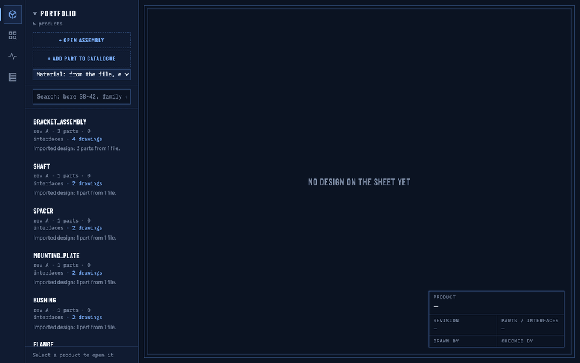
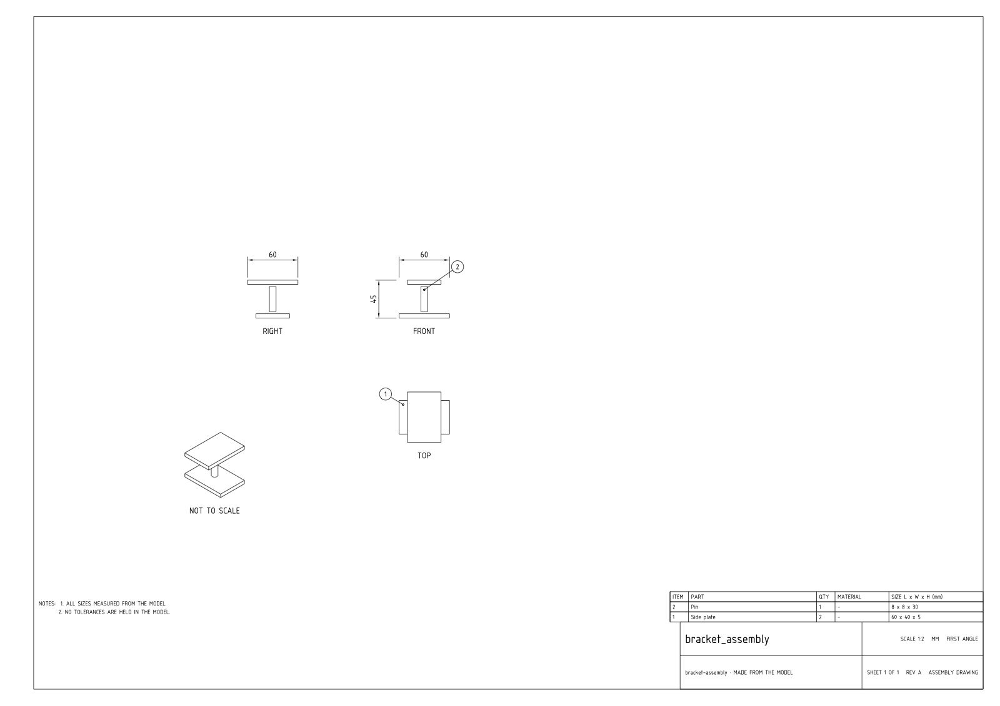
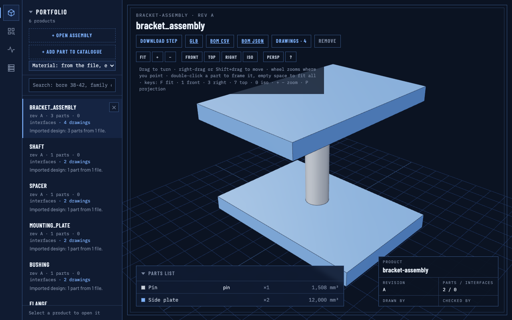

# Buildcore

Give it a STEP file: get a dimensioned engineering drawing, a bill of materials with identical parts counted, a 3D model in the browser and a searchable parts catalogue.



The demo above was recorded from a fresh `docker compose up`: the sample assembly is opened, its parts list picked,
its drawings shown (assembly sheet, then a part sheet), then the 3D view and a catalogue search by bore diameter.

## Quick start

Requires Docker with Compose.

```sh
git clone https://github.com/naman113/Designstudio.git
cd Designstudio
docker compose up -d
```

Open http://127.0.0.1:8800.

The first start builds the image and then loads six sample files: five single parts (flange, bushing, mounting plate,
shaft, spacer) and a small assembly (`bracket_assembly`: two side plates and a pin). The assembly's drawings are made
on that first start, so it is ready to look at as soon as the loader has finished.

- Stop: `docker compose down` (your designs and the catalogue are kept in Docker volumes).
- Full reset to an empty studio: `docker compose down -v`. This removes every volume of the stack. Removing only the
  database volume is not enough, because the designs and drawings live in other volumes; on the next start the samples
  are loaded again.
- Another host port: `BC_PORT=8810 docker compose up -d` (the studio is always bound to 127.0.0.1 only).
- After changing the code: `docker compose up -d --build`.

In the studio, **Open assembly** opens a STEP file as a design (drawings, BOM, 3D) and **Add part to catalogue** adds a
single part to the catalogue. The catalogue page is the grid icon in the left rail.

## What you get

- **Part drawings.** One sheet per distinct part, first-angle projection, with the views and dimensions placed
  automatically. Sheet size (A3 to A0) and scale are chosen automatically: the first standard size and scale where the
  views fit with no text or dimension overlapping (if none does, the fit with the fewest overlaps, and their count is
  reported).
- **Assembly drawing.** Front, top and right views plus a three-quarter view, balloons on every part and a parts list
  (item, part, quantity, material, size L x W x H).
- **Bill of materials.** Identical parts are grouped and counted, also when the copies are rotated or moved. Download as
  CSV or JSON.
- **3D view.** The design in the browser (three.js): turn, zoom, standard views, pick parts from the parts list. The model
  can be downloaded as GLB.
- **Parts catalogue.** Every single part with its measured length, width and height, volume, surface area, mass (from
  the material's density), bore and outer diameters, hole count and material. Filters are exact ranges (bore 10 to 40 mm
  returns only parts with a measured bore in that range), plus family, material and name words.
- **Web UI and CLI.** The same functions from the browser or from the command line.

## Example outputs

All of these were produced by the app from the sample `bracket_assembly`:

- Assembly drawing: [PDF](docs/examples/bracket_assembly-assembly.pdf), and as an image below
- Part drawing (side plate): [PDF](docs/examples/bracket_assembly-part.pdf)
- Bill of materials: [CSV](docs/examples/bracket_assembly-bom.csv)
- 3D view and a catalogue search: [3D view](docs/examples/bracket_assembly-3d.png),
  [catalogue, bore 10 to 40 mm](docs/examples/catalogue-filter.png)





The BOM CSV:

```
item,name,qty,material,bought_in,ref
1,Side plate,2,-,no,BRACKET_ASSEMBLY_SIDE_PL
2,Pin,1,-,no,BRACKET_ASSEMBLY_PIN
```

## CLI

The CLI talks to the running stack, so start it first with `docker compose up -d`.

The examples below use the sample STEP files. A clone does not contain them (they are generated), so write them into
`buildcore-samples/` first (on Linux add `--user "$(id -u):$(id -g)"` after `run` so the files belong to you):

```sh
docker compose run --rm --entrypoint python cli -m framework.samples.make buildcore-samples
```

**Through Docker** (nothing to install). The repository folder is mounted as the working folder, so the STEP file must be
in it and the outputs are written next to it:

```sh
docker compose run --rm cli drawing buildcore-samples/bracket_assembly.step
```

**On the host** with plain `python3` (standard library only), from a clone:

```sh
scripts/buildcore drawing buildcore-samples/bracket_assembly.step            # drawing sheets (PDF) and the views sheet (PNG)
scripts/buildcore bom buildcore-samples/bracket_assembly.step --format csv   # bill of materials as CSV (or --format json)
scripts/buildcore glb buildcore-samples/bracket_assembly.step                # 3D model as GLB
scripts/buildcore add buildcore-samples/spacer.step --material bronze --name spacer_bronze   # add one part to the catalogue
scripts/buildcore find --bore 10:40                  # search the catalogue: parts with a bore of 10 to 40 mm
```

Every command works the same through Docker: replace `scripts/buildcore` with `docker compose run --rm cli`.

- `drawing`, `bom` and `glb` open the STEP file as a temporary design, fetch the result and remove the design again
  (`--keep` keeps it in the studio). `--id <product id>` uses a design that is already in the studio instead of a file.
- Outputs go to `./buildcore-out/<name>/`; `-o DIR` writes them elsewhere.
- `add` takes a file holding one solid; an assembly is refused with a message to add each part on its own.
- `find` takes ranges as `MIN:MAX` for `--bore`, `--od`, `--length`, `--width`, `--height`, `--volume`, `--mass` and
  `--holes`, plus `--family`, `--material`, `--words`, `--sort`, `--limit` and `--json`.
- `--url` (before the command) points at another stack; the default is `BUILDCORE_URL`, else http://127.0.0.1:8800.
- `scripts/buildcore <command> --help` lists every option.

## How it works

- **Geometry.** STEP files are read with build123d on the OpenCASCADE kernel (OCP). Each solid is measured from the
  B-rep: bounding box, volume, surface area, principal moments of inertia, cylindrical faces (bores and outer
  diameters) and holes.
- **Drawings with a read-back check.** Every number printed on a sheet is measured from the model. After a sheet is
  drawn, its printed text is read back from the finished sheet and compared with values recomputed from the geometry. A
  wrong, missing or unexplained number fails the check. A part or assembly sheet that fails is not written: the part is
  listed as failed with the reason. The
  sheet engine is derived from cadgen and uses the osifont lettering font (ISO 3098).
- **Identical parts.** Parts are grouped by their measured volume, surface area, principal moments, face count and
  material. These do not change when a part is moved or rotated, so rotated copies count as one line with a quantity.
- **Catalogue.** The measured values are stored in Postgres and the filters are plain SQL ranges on those columns.
- **Stack.** `docker compose up` runs Postgres (pgvector image, with the vendored pgmq extension for the job queue
  between the services) and the app: a gateway with the web UI on port 8800, an orchestrator, a catalogue service and a
  geometry service. A one-shot `init` service loads the samples.

## Configuration

Environment variables read by `docker compose`:

| Variable | Default | Meaning |
|----------|---------|---------|
| `BC_PORT` | `8800` | host port of the studio, bound to 127.0.0.1 |
| `BC_PG_USER`, `BC_PG_PASSWORD` | `buildcore` / `buildcore` | database role; Postgres takes them only when it creates a new database volume. Use only letters, digits and `- . _ ~` |
| `BUILDCORE_DRAWN_BY` | blank | the "Drawn by" name in the studio's title block |
| `BUILDCORE_CHECKED_BY` | blank | the "Checked by" name in the studio's title block |
| `BC_APP_IMAGE` | `buildcore-app:local` | tag of the app image that compose builds and runs |
| `BC_VOLUME_PREFIX` | `buildcore` | prefix of the named volumes (`<prefix>-pgdata`, `<prefix>-sqlite`, ...) |

The database is not published outside the compose network.

## Running the tests

The tests run in the app image on the generated sample parts. From the repository root:

```sh
docker compose build
docker compose run --rm --no-deps --entrypoint python cli -m pytest -m "not stack"
```

The stack tests need the running stack with the samples loaded:

```sh
docker compose up -d
docker compose run --rm --no-deps -e BC_REQUIRE_STACK=1 --entrypoint python cli -m pytest -m stack
```

The stack tests add and remove their own probe parts and leave the studio as they found it. The same commands run in
CI (`.github/workflows/ci.yml`) on every push and pull request.

## Licence and credits

Buildcore is released under the MIT licence: see [LICENSE](LICENSE).

It builds on these projects, each under its own licence:

- cadgen (MIT): the drawing sheet engine that `framework/kernel/drawings/sheet.py` is derived from
- osifont: the ISO 3098 lettering font embedded in the drawings
- build123d (Apache-2.0) and OCP / OpenCASCADE Technology (Apache-2.0 / LGPL-2.1 with exception): the CAD kernel
- pgmq (PostgreSQL licence): the job queue in Postgres
- pgvector and PostgreSQL: the database image
- three.js (MIT): the 3D view
- pdf.js (Apache-2.0): the drawing viewer

Versions, sources and full licence texts are in [THIRD_PARTY_LICENSES](THIRD_PARTY_LICENSES).
